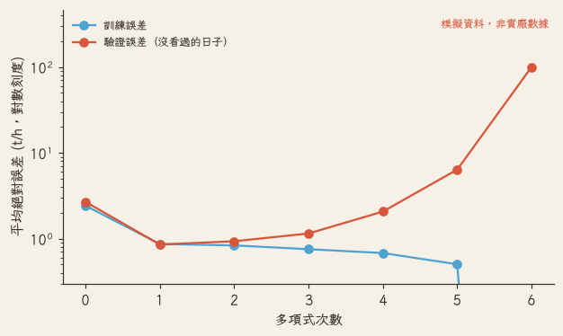
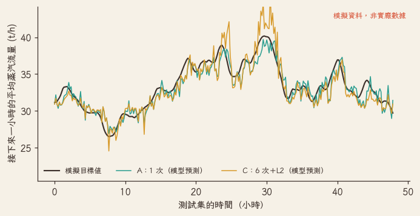

# EP04 過度擬合圖解：Google 流感趨勢，為什麼估到疾管中心的兩倍以上？

影片 Video：即將上架 · [English below](#english)

## 在舊資料上很準，為什麼遇到新資料就不準？

2014 年，《科學》期刊的一篇文章指出，Google 流感趨勢在 2013 年初估計的類流感就醫比例，是美國疾管中心數字的兩倍以上；從 2011 年 8 月到 2013 年 9 月，108 週裡有 100 週估得太高。它最初的版本，是拿 5000 萬個搜尋關鍵字去比對 1152 個流感資料點，挑出最吻合的那些；連高中籃球這種和流感無關的關鍵字都曾經很吻合。文章說原因不只一個，其中一個，機器學習叫它過度擬合。

**故意讓模型太有彈性。** 沿用 EP03 的焚化爐模擬資料，但只給模型 8 天、每小時一筆，共 191 筆訓練資料，再把感測器的平方、三次方和彼此相乘放進式子（多項式特徵）。次數越高，模型能彎的地方越多。

*次數從 1 加到 5，訓練誤差一路下降；到了 6 次，式子有 210 個係數，比 191 筆資料還多，訓練誤差幾乎是零。換成模型沒看過的 6 天，誤差卻從 0.85 升到 6.39，6 次超過 100（對數刻度；模擬資料）。*

**模型記住了什麼。** 感測器讀數裡有規律，也有雜訊；彈性太大的模型會連這 191 筆裡的雜訊一起記下來，而雜訊每天都不一樣。我學控制時也遇過類似的事：把 PID 參數調到剛好適合某一種工況，負載一變，反應就變差。

**訓練集、驗證集、測試集。** 拿去算權重的叫訓練集，用來比較不同設定的叫驗證集，最後還要留一份測試集，等設定都決定好了只評估一次。焚化爐資料是按時間排的，所以要用前面的日子訓練、後面的日子驗證：如果把每分鐘的資料打散再分，相鄰兩筆的答案（接下來 60 分鐘的平均）有 59 分鐘相同，等於考試偷看了答案。我訓練 YOLO 時也一樣：訓練 loss 還在降，驗證集的結果卻沒變好，就該停下來看看了。

**L2 正則化。** 過度擬合的 6 次模型，最大的權重絕對值接近 4000（1 次模型約 2）。L2 正則化在損失裡加上「λ × 所有權重的平方和」，權重越大罰越重；λ 用驗證集來挑。加上之後，最大權重絕對值降到 1 左右，驗證誤差從 100 降到 1.07。

*設定鎖定之後才打開的測試集：用另一組亂數模擬的全新 4 天。1 次模型誤差 0.87，6 次＋L2 為 1.14，6 次不罰為 148（圖中只畫前兩者；模擬資料）。*

**結論與限制。** 在這組模擬資料裡，正則化能拉住太貪心的模型，但誤差最低的還是 1 次模型。回到 Google：文章比較過，只用疾管中心前幾週的數字加上季節規律的簡單模型，樣本外平均絕對誤差 0.311，比 Google 流感趨勢的 0.486 小，兩者合併 0.232 更小。文章也提醒，問題不只是過度擬合，搜尋演算法和大家的搜尋習慣都在變；上線後資料一變，過去的測試成績就可能不再代表現在的表現，所以模型上線後還要持續檢查。

## English: accurate on old data, wrong on new data

In 2014 *Science* reported that Google Flu Trends had estimated more than double the CDC's proportion of influenza-like-illness doctor visits in early 2013, overestimating in 100 of 108 weeks (Aug 2011–Sep 2013). Its initial version matched 50 million search terms against 1,152 data points; one of the causes named was overfitting.

The notebook reproduces the effect on the simulated incinerator data from EP03, with only 191 hourly training rows. Polynomial features of degree 1–5 steadily lower the training error; at degree 6 the model has 210 coefficients (more than the rows) and a training error near zero, while the error on six unseen days rises from 0.85 to above 100 t/h. Data are split by time into training, validation and test sets, never shuffled: adjacent minutes share 59 of the 60 minutes in their one-hour-ahead target, so shuffling would leak answers. L2 regularization (λ times the sum of squared weights, λ chosen on the validation set) shrinks the largest weight of the degree-6 model from about 4,000 to about 1 and its validation error to 1.07. After all settings were locked, a fresh 4-day test set simulated with a different seed was evaluated exactly once: degree 1 scored 0.87, degree 6 + L2 1.14, unregularized degree 6 148. In this simulated dataset the linear model is still the best. The paper also found that a simple model using lagged CDC data plus seasonality beat Google Flu Trends (MAE 0.311 vs 0.486; combined 0.232), and warned that search algorithms and user behaviour change, so deployed models need ongoing monitoring.

---

| 檔案 File | 說明 |
|---|---|
| `notebook.ipynb` | 產生影片中焚化爐範例的每一張資料圖和每一個數字（seed 2026；測試集 seed 2027） |
| `data/v05.json` | notebook 匯出、給影片動畫使用的資料 |
| `figures/` | 本文使用的圖，皆由 notebook 產生 |

焚化爐資料皆為**模擬資料，非實廠數據**，不代表任何一座真實焚化廠。Google 流感趨勢的數字取自 Lazer, D., Kennedy, R., King, G., & Vespignani, A. (2014). The parable of Google Flu: Traps in big data analysis. *Science*, 343(6176), 1203–1205. https://doi.org/10.1126/science.1248506 。本文與影片腳本由 AI 協助整理，內容經作者查證。
All incinerator data are simulated and do not describe any real plant. Text drafted with AI assistance and checked by the author.
