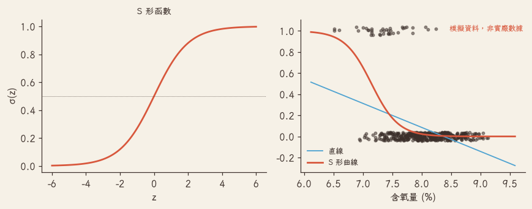
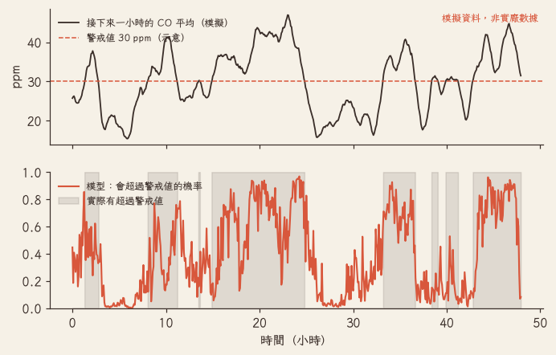
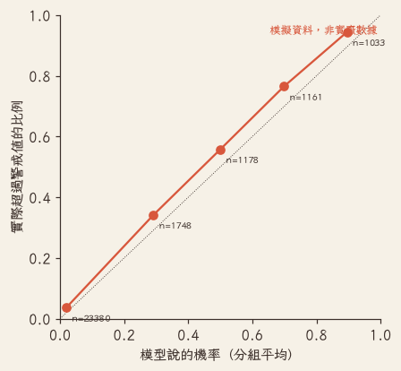

# EP05 邏輯斯迴歸圖解：颱風假放不放，機率能告訴我們什麼？

影片 Video：即將上架 · [English below](#english)

## 要回答「會不會」，模型應該輸出什麼？

颱風要來的時候，很多人最關心的是明天放不放颱風假。2026 年 7 月 10 日巴威颱風來的時候，同一天就有縣市放、有縣市沒放。依《天然災害停止上班及上課作業辦法》，全日或上午半日停班停課，要在前一天晚上 7 點到 10 點之間發布；那時候沒有人能確定明天的風雨，中央氣象署能給的，是暴風吹到當地的機率。可是最後要回答的只有兩種：放，或不放。

**從數字換成「會不會」。** 沿用 EP03、EP04 的焚化爐模擬資料和同樣 4 個感測器（進料量、一次空氣流量、爐溫、含氧量），這一集換一個問題：接下來一小時的一氧化碳（CO）平均濃度，會不會超過警戒值。法規要求煙道 CO 一小時動平均低於 100 ppm；我們另外自訂一個比較低的警戒值 30 ppm，超過記 1，沒超過記 0。我學 PLC 和 HMI 時設過的警報，還有工作上看到的 IoT 畫面，都是同一種做法：數值超過警戒值，警報才跳出來。

**先猜數字、或用直線配 0 和 1，都不好。** 照 EP03 先猜 CO 是多少 ppm 再和 30 比，驗證資料裡有一分鐘猜 25.6 ppm（判定沒超過），實際是 38.1；只給一個數字，看不出它在警戒值附近有多少把握。把 0 和 1 當成數字直接用直線去配，只看含氧量時，含氧量高過約 8.4%，直線給的值就變成負的；機率不可能是負的。

*只用含氧量的示範：直線在含氧量高的地方掉到 0 以下；先加權、再套 S 形函數（Sigmoid）的曲線永遠在 0 到 1 之間，含氧量低於約 7.15% 時超過警戒值的機率過半（模擬資料）。*

**邏輯斯迴歸與交叉熵。** 先算出 EP03 的加權總和 z，再丟進 S 形函數，就是邏輯斯迴歸。要學權重，用的是交叉熵：看模型給正確答案多少機率，再取負的對數。假設一筆資料答案是 1，模型卻說只有 1%：交叉熵罰 4.61；換成平方誤差，S 形曲線在那裡已經很平，這一筆推動模型的力道（對 z 的梯度大小）只剩 0.0196，交叉熵是 0.99，大約 50 倍。猜錯又有把握就罰得很重，模型才會被推著改。之後一樣是標準化加梯度下降：訓練集交叉熵從 0.693（每分鐘都猜 50%）降到 0.119；驗證集 0.293，比每分鐘都猜訓練期超過比例的 0.581 少了大約一半。

**測試集：全新的 20 天，只評估一次。** 設定鎖定後第一批打開的 4 天，一次超過警戒值的案例都沒有，無法檢查漏報和機率準不準；模型不改，改用另外 5 段、共 20 天的模擬資料評估。整個測試集的交叉熵 0.185（每分鐘都猜訓練期比例：0.424）。

*測試集中超過警戒值最多的 48 小時（依超過的分鐘數挑出）：上面是接下來一小時的 CO 平均，下面紅線是模型每一分鐘給的機率，灰色是真的超過的時段（模擬資料）。*

*把測試集每一分鐘按模型說的機率分 5 組：模型說 0.70 左右時，實際 0.76 真的超過；說 0.89 左右時，實際 0.94。在這組模擬資料裡，每一組實際超過的比例都比模型估的高一點（模擬資料）。*

**門檻與決策。** 有了機率，還要決定機率多高才發警報，這個數叫門檻。警戒值 30 ppm 決定答案是 0 還是 1，門檻決定警報要不要響，這是兩件事。門檻設 0.3，整個測試集約 14.5% 的時間會發警報；0.5 約 9.8%；0.7 約 5.6%。我跑 YOLO 時也調過信心門檻：調低，框出來的東西變多，調高就變少。要設多少，得看漏報和誤報哪一種代價比較大，這是下一集的主題。如果在真實資料上也驗證過，它可以當成提醒操作員的助理；模型只負責給機率，最後怎麼做，還是由人決定。

**回到颱風假。** 氣象署給的是機率和風雨預報，放不放是縣市首長的決定；氣象署人員也說過，除了風雨預報，還會參考當地交通和水電是不是正常。機率只回答「有多可能」，要不要放，還要加上其他考量和對兩種錯的取捨。

## English: when the answer is yes or no, output a probability

Before a typhoon, people in Taiwan ask one thing: will tomorrow be a typhoon day off? On 10 July 2026 (Typhoon Bavi), some cities and counties closed while others did not. A full-day closure must be announced between 7 and 10 p.m. the evening before, when nobody can be sure about tomorrow's weather; what the Central Weather Administration can give is the probability that typhoon-force winds reach the area. The final answer, however, is only yes or no.

The notebook asks a yes/no question on the simulated incinerator data from EP03–EP04, with the same four sensors: will the average carbon-monoxide (CO) concentration over the next hour exceed a self-set warning level of 30 ppm (the legal limit is a one-hour moving average below 100 ppm)? Predicting the CO value and comparing it with 30 gives no sense of confidence (one validation minute: predicted 25.6, actual 38.1), and fitting a straight line to the 0/1 labels goes negative (oxygen only: below zero above about 8.4% O₂). Logistic regression passes the weighted sum z through the sigmoid, so the output always stays between 0 and 1, and is trained with cross-entropy. For a single example with label 1 and predicted probability 0.01, cross-entropy is 4.61 and its gradient with respect to z is 0.99, about 50 times the 0.0196 of squared error, which barely moves a saturated sigmoid. With standardized inputs and gradient descent, training cross-entropy falls from 0.693 to 0.119; validation is 0.293 versus 0.581 for always predicting the training-period rate.

After all settings were locked, the first 4-day test batch contained no exceedances at all, so it could not check missed alarms or calibration; the model was kept unchanged and evaluated once on five further simulated segments (20 days). Test cross-entropy is 0.185 (baseline 0.424). Grouped by predicted probability, outcomes are close to the stated values but slightly higher in every group (0.70 → 0.76, 0.89 → 0.94) in this simulated dataset. The decision threshold is a separate choice from the 30 ppm warning level: thresholds of 0.3 / 0.5 / 0.7 would raise an alarm 14.5% / 9.8% / 5.6% of the time. If validated on real data, such a model could serve as an assistant that reminds operators; the model gives a probability, and people make the decision.

---

| 檔案 File | 說明 |
|---|---|
| `notebook.ipynb` | 產生影片中焚化爐範例的每一張資料圖和每一個數字（訓練／驗證 seed 2026；測試集 seed 2030–2034；seed 2028 為第一次打開、沒有超過案例的那一批） |
| `data/v06.json` | notebook 匯出、給影片動畫使用的資料 |
| `figures/` | 本文使用的圖，皆由 notebook 產生 |

焚化爐資料皆為**模擬資料，非實廠數據**，不代表任何一座真實焚化廠；30 ppm 是為了示範自訂的警戒值，不是法規標準。法規：《廢棄物焚化爐戴奧辛管制及排放標準》第 7 條（https://law.moj.gov.tw/LawClass/LawAll.aspx?pcode=O0020031 ）；《天然災害停止上班及上課作業辦法》第 9、10 條（https://law.moj.gov.tw/LawClass/LawAll.aspx?pcode=S0110022 ）。暴風侵襲機率的意義：中央氣象署 https://www.cwa.gov.tw/V8/C/P/Typhoon/TY_NEWS.html 。交叉熵與 S 形輸出：Goodfellow, I., Bengio, Y., & Courville, A. (2016). *Deep Learning*, 6.2.2.2. https://www.deeplearningbook.org/contents/mlp.html 。本文與影片腳本由 AI 協助整理，內容經作者查證。
All incinerator data are simulated and do not describe any real plant; 30 ppm is an illustrative warning level, not a legal limit. Text drafted with AI assistance and checked by the author.
