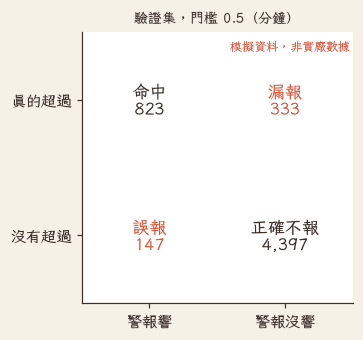
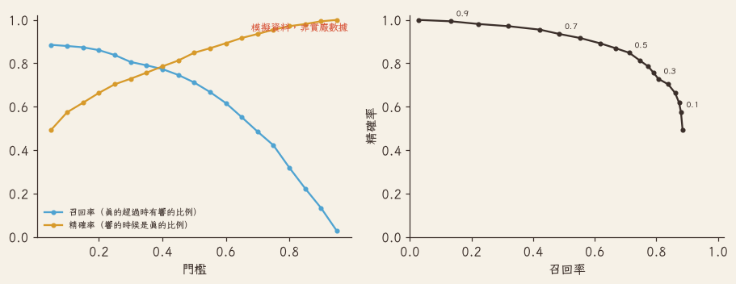
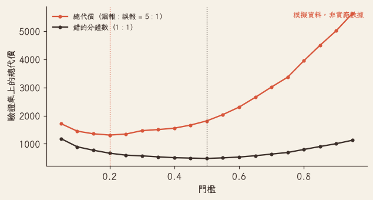

# EP06 混淆矩陣圖解：準確率 87%，為什麼還不夠？

影片 Video：即將上架 · [English below](#english)

## 評一個警報系統，只算「對了幾次」，夠嗎？

2024 年 4 月 3 日花蓮規模 7.1 的地震，台北市、新北市實際最大震度都到 5 弱，但系統預估不到 4 級，不在當時國家級警報的發送範圍裡。2025 年 5 月 14 日嘉義大埔規模 4.6 的地震，最大震度只有 1 級的花蓮、台東，也被列入警報範圍。一次該響沒響，一次不該響卻響了，正是 EP05 最後問的兩種錯。（時間、規模、震度與發送範圍依中央氣象署地震資訊第 019 號、第 097 號。）

**四種結果：混淆矩陣。** 沿用 EP05 的焚化爐模擬資料和邏輯斯迴歸模型，一個數字都不改：模型每一分鐘估計「接下來一小時的一氧化碳（CO）平均，會不會超過自訂的警戒值 30 ppm」的機率，機率達到或超過門檻就響警報。每一分鐘拿兩件事來對：真的有沒有超過，警報有沒有響。真的超過、警報也響，叫**命中**（TP）；沒超過、也沒響，叫**正確不報**（TN）；真的超過卻沒響，是**漏報**（FN）；沒超過卻響了，是**誤報**（FP）。把四種結果的分鐘數排成 2×2 的表，就是混淆矩陣。這裡數的是分鐘：同一段警報響了五分鐘，就記五分鐘。

*驗證集 4 天（5,700 分鐘），門檻 0.5：命中 823、漏報 333、誤報 147、正確不報 4,397 分鐘（模擬資料）。*

**準確率的陷阱。** 準確率是做對的分鐘數除以全部的分鐘數，這個模型在驗證集上是 91.6%。可是換成一個什麼都不做的辦法，警報永遠不響，準確率也有 79.7%，因為驗證集裡 79.7% 的時間本來就沒超過。超過越少見，永遠不響的準確率就越高；只看準確率，看不出漏掉了多少。

**精確率與召回率。** 精確率問：警報響的時候，有幾成是真的（誤報越多，它越低）。召回率問：真的超過的時候，有幾成警報有響（漏報越多，它越低）。門檻 0.5 時，精確率 84.8%、召回率 71.2%；永遠不響的召回率是 0。把門檻從 0.5 降到 0.2，召回率升到 86.1%，精確率掉到 66.3%。我跑 YOLO 的時候調過 confidence 門檻，框變多、變少，其實也是在這兩個數字之間拉扯。

*門檻從 0.05 到 0.95（每 0.05 一格），在驗證集上各算一次。左：門檻越低，召回率越高、精確率越低；右：同一組結果畫成精確率對召回率（模擬資料）。*

**哪一種錯比較糟？看代價。** 沒有標準答案。漏報代表 CO 真的超過警戒值時沒有人被提醒；誤報代表操作員白忙一場，響太多次，大家可能就像聽到「狼來了」不再理會。這裡**假設**漏報一分鐘的代價是誤報一分鐘的 5 倍（示意，不是任何工廠的規定），把每個門檻的兩種錯換成代價加起來：在驗證集上試過的門檻裡，總代價最小的是 0.2。如果兩種錯一樣貴（1 : 1），總代價就是錯的分鐘數，選出來的會是 0.5，也是這些門檻裡準確率最高的（91.6%）。也就是說，用準確率選門檻，等於把漏報和誤報的每一分鐘都算成一樣貴。

*驗證集上每個門檻的總代價：紅線是漏報 : 誤報 = 5 : 1，黑線是 1 : 1（＝錯的分鐘數）。兩條虛線分別在 0.2 和 0.5（模擬資料）。*

**測試集：全新的 40 天，只評估這一次。** 門檻鎖定在 0.2 之後，才產生另外模擬的 10 段、共 40 天（57,000 分鐘）測試集。召回率 67.8%、精確率 48.9%，兩個數字都比驗證集低，這就是為什麼一定要留一份沒看過的資料來量。門檻 0.2 的準確率 86.9%，比永遠不響的 87.3% 還低一點，也比門檻 0.5 的 90.1% 低；可是永遠不響一次都沒抓到，而選 0.2 本來就是為了少漏報。照 5 : 1 的代價算，門檻 0.2 的總代價 16,844，比門檻 0.5 的 21,895 少約 23%（永遠不響：36,310）。各段的差別很大：超過警戒值的比例從 1.6% 到 33.9%，超過很少的那幾段，精確率和召回率都很低。這些結論只代表這組模擬資料。真的要用在工廠，代價比例要和現場的人一起訂，訂好了，再用驗證集選門檻；也要先在真實資料上驗證過。

**回到國家級警報。** 中央氣象署的說明寫到，系統會自動利用近震央少數地震站最早接收到的前幾秒 P 波資料進行即時演算，完全由系統快速自動演算，「因此有一定程度風險造成誤報或是漏報」。2024 年 9 月 1 日起，氣象署新增一個發布條件：預估規模 6.5 以上時，預估震度 3 級以上的縣市也會發送，新聞稿寫的目的之一是「避免漏報」。門檻放在哪裡，要看兩種錯各自的代價，這是要由人來決定的取捨。

## English: why 87% accuracy is not enough

In the 3 April 2024 Hualien earthquake (magnitude 7.1), Taipei City and New Taipei City reached a maximum intensity of 5-lower, but the early estimate for them was below 4, so they were outside the national-alert area at the time. On 14 May 2025, a magnitude 4.6 earthquake in Dapu, Chiayi, put Hualien and Taitung, where the maximum intensity was only 1, inside the alert area. One alert that should have sounded and did not, one that sounded when it did not need to: the two kinds of error that EP05 ended on. (Times, magnitudes, intensities and alert areas follow Central Weather Administration earthquake reports No. 019 and No. 097.)

The notebook keeps the EP05 simulated incinerator data and logistic-regression model unchanged. Every minute, the model estimates the probability that the next-hour average carbon-monoxide (CO) level will exceed a self-set warning level of 30 ppm, and the alarm sounds when the probability reaches the threshold. Comparing alarm with outcome minute by minute gives four counts, arranged as a 2×2 confusion matrix: hit (TP), missed alarm (FN), false alarm (FP) and correct silence (TN). On the 4-day validation set (5,700 minutes) at threshold 0.5: 823 / 333 / 147 / 4,397 minutes. Accuracy is 91.6%, but an alarm that never sounds already scores 79.7%, because the level is not exceeded 79.7% of the time. Precision (how often an alarm is real) is 84.8% and recall (how often a real exceedance triggers the alarm) is 71.2%; lowering the threshold to 0.2 raises recall to 86.1% and lowers precision to 66.3%.

Assuming, for illustration only, that one missed minute costs five times as much as one false-alarm minute, the threshold with the lowest total cost among those tried on the validation set (0.05 to 0.95 in steps of 0.05) is 0.2; with equal costs it is 0.5, which is also the most accurate. Choosing a threshold by accuracy therefore treats both errors as equally costly. After the threshold was locked, a fresh simulated test set (10 segments, 40 days, 57,000 minutes) was evaluated once: recall 67.8%, precision 48.9%, accuracy 86.9% (never-alarm 87.3%, threshold 0.5 90.1%), and a 5 : 1 total cost of 16,844 versus 21,895 at threshold 0.5, about 23% lower. Results vary widely between segments, and all conclusions hold only for this simulated dataset. In a real plant, the cost ratio should be agreed with the people on site, and the model validated on real data first.

---

| 檔案 File | 說明 |
|---|---|
| `notebook.ipynb` | 產生影片中焚化爐範例的每一張資料圖和每一個數字（訓練／驗證 seed 2026，與 EP05 相同；測試集 seed 2035–2041、2043–2045，seed 2042 的模擬結果超出設定的感測器範圍，產生測試集時依事先寫好的規則跳過） |
| `data/v07.json` | notebook 匯出、給影片動畫使用的資料 |
| `figures/` | 本文使用的圖，皆由 notebook 產生 |

焚化爐資料皆為**模擬資料，非實廠數據**，不代表任何一座真實焚化廠；30 ppm 是為了示範自訂的警戒值，不是法規標準（法規：《廢棄物焚化爐戴奧辛管制及排放標準》第 7 條，煙道 CO 一小時動平均低於 100 ppm，https://law.moj.gov.tw/LawClass/LawAll.aspx?pcode=O0020031 ）；「漏報 1 分鐘＝誤報 5 分鐘」是示範用的假設。
地震資料：中央氣象署 地震資訊第 019 號 https://scweb.cwa.gov.tw/zh-tw/earthquake/details/2024040307580971019 、第 097 號 https://scweb.cwa.gov.tw/zh-tw/earthquake/details/2025097 ；新聞稿（2024/4/3）https://www.cwa.gov.tw/Data/service/Newsbb/CH/Newsbb_20240403225329.pdf ；地震測報中心 PWS 說明 https://scweb.cwa.gov.tw/zh-tw/pws/info_d/2 ；新聞稿（2024/8/30）新增發布條件 https://www.cwa.gov.tw/Data/service/Newsbb/CH/Newsbb_20240830105840.pdf 。名詞：Google Machine Learning Crash Course, Classification https://developers.google.com/machine-learning/crash-course/classification/thresholding 。本文與影片腳本由 AI 協助整理，內容經作者查證。
All incinerator data are simulated and do not describe any real plant; 30 ppm is an illustrative warning level, not a legal limit, and the 5 : 1 cost ratio is an illustrative assumption. Text drafted with AI assistance and checked by the author.
