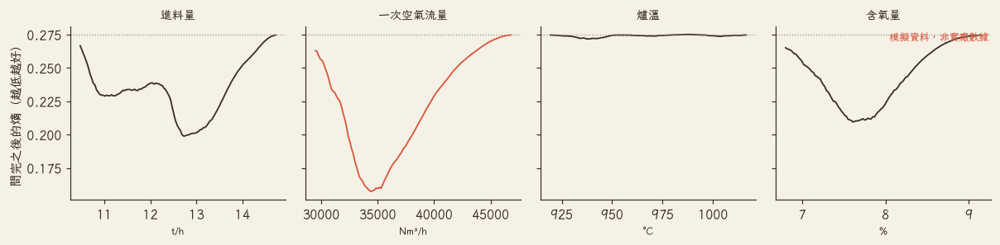
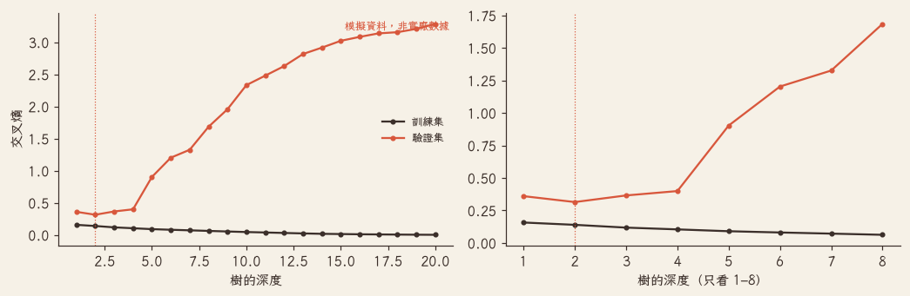
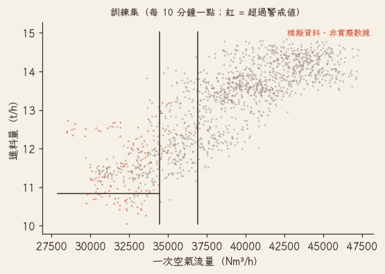

# EP07 決策樹圖解：一題一題問下去，先問哪一題？

影片 Video：即將上架 · [English below](#english)

## 一題一題問下去的規則，模型學得出來嗎？

2025 年，台灣的金融機構在臨櫃攔阻了 14,259 件詐騙，金額超過 112 億元（金管會新聞稿，2026/8/31）。金管會 2016 年的新聞稿，列了幾種行員要主動關心的情況，像是年長者提領現金三萬元以上，或是客人神色慌張、一直講著手機。這些情況是人寫下來的規則。EP06 最後的問題是：這種一題一題問下去的規則，模型能不能自己從資料裡學出來？

**題目和 EP05、EP06 一樣。** 焚化爐的模擬資料，每一分鐘判斷：接下來一小時的一氧化碳（CO）平均，會不會超過自訂的警戒值 30 ppm。EP05 的答案是一條加權公式（邏輯斯迴歸）：它算得出機率，可是四個感測器彼此連動，單看哪一個權重都很難解讀。這一集換一種模型：像操作手冊那樣，一次只問一題。

**一題＝一個感測器＋一個切點。** 這一集的決策樹，每一題都長一樣：某一個感測器，有沒有小於或等於某個值，這個值叫切點。拿 EP06 最後畫的「含氧量 7% 以下嗎」來問，訓練資料分成兩群：答「是」的 197 分鐘裡 76.6% 超過警戒值，答「否」的 14,143 分鐘裡只有 6.9%（全部是 7.9%）。我學 PLC 和 HMI 時設過的警報，也是拿一個數值來比；這次比哪個感測器、比多少，交給資料挑。

**先問哪一題：熵。** 把四個感測器、每一個可能的切點都試一遍，看分出來的兩群混不混：全部超過或全部沒超過最乾淨，一半一半最混。這個混的程度叫做熵；它其實就是 EP05 的交叉熵：每一群都拿自己超過警戒值的比例當機率去猜，平均被罰多少（scikit-learn 文件：以熵切分，等同於最小化 log loss）。兩群的熵照各自的分鐘數加權平均，哪一題問完降得最多，就先問哪一題。在這組模擬資料裡，第一題選的是「一次空氣流量 ≤ 34,473 Nm³/h」，熵從 0.275 降到 0.157，少了 43%；只問含氧量的話，最好也只降到 0.209。

*四個感測器、每個切點問完之後的熵（越低越好），訓練集。一次空氣流量最低（模擬資料）。*

**一直問下去：長成一棵樹。** 答「是」和答「否」的兩群，各自再用同樣的方法挑下一題。兩層的樹有四片葉子，每片葉子給一個機率：訓練資料走到這片葉子的分鐘裡，有幾成超過警戒值。一次空氣流量 ≤ 34,473 而且進料量 ≤ 10.84 t/h 的葉子是 77.6%（305 ÷ 393 分鐘）；其他三片是 31.5%、3.1%、0.01%。

**樹太深，會背答案。** 樹越問越深，訓練集的交叉熵一路往下，問到第 20 層只剩 0.002：葉子越切越小，第 20 層時 99.6% 的訓練分鐘落在只剩一種答案的葉子裡，等於把答案背了下來。這種葉子說的機率不是 0% 就是 100%，在驗證集上一猜錯就罰得很重。試過的 1 到 20 層裡，驗證集交叉熵在第 2 層最低（0.314），再深就一路變差，就是 EP04 的過度擬合。所以只留兩層。

*訓練集（黑）與驗證集（紅）的交叉熵，對應樹的深度 1–20；右圖只看 1–8。虛線是選出的深度 2（模擬資料）。*

**讀得懂的規則。** 兩層的樹可以直接寫成四行規則，一張卡片就寫得下。不過，讀得懂不代表就是原因：四個感測器彼此連動，樹先問一次空氣流量，是因為它在訓練資料裡最能把兩種分鐘分開，這不等於證明它就是原因。從資料長出流程圖也不是新點子：1982 年 Goldman 等人在 *New England Journal of Medicine* 發表的研究，用 recursive partitioning 從 482 位胸痛病人的資料長出判斷心肌梗塞的流程圖；拿到另一家醫院的 468 位病人上測，表現和醫師差不多，但作者也寫，還不能直接拿來看診（“not ready for routine clinical use”）。

*訓練集，每 10 分鐘一點，紅點是超過警戒值的分鐘；直線、橫線是兩層樹的切點（模擬資料）。*

**結果：樹和公式，各評一次。** 門檻都照 EP06 的規則在驗證集上選（漏報的代價算成誤報的五倍）：樹 0.05（0.05–0.30 結果都一樣：第一題答「是」就響），EP05 的公式 0.20。全新的 40 天（57,000 分鐘）測試集只評一次：樹的召回率 95.6%（漏報 355 分鐘），公式 81.8%（1,460）；樹的精確率 42.3%（誤報 10,420 分鐘，幾乎多一倍），公式 54.3%（5,503）。照五比一算總代價，樹 12,195、公式 12,803，樹少約 5%；但在驗證集上反而是公式比較低（1,310 對 1,399）。機率準不準看交叉熵，公式比較好（0.212 對 0.268），兩層的樹也只說得出四種機率。在這組模擬資料裡，兩邊的總代價差不多，樹換來的是一張讀得懂的卡片。

**弱點與回到櫃台。** 資料稍微變一點，樹就可能長得不一樣：只拿掉最後一天，答「是」那一邊的第二題就從進料量換成了含氧量。已經有銀行和刑事局合作，用詐騙案例的資料來驗證和更新模型，幫第一線行員辨識異常（經濟日報，2026/5/22）。模型只會問資料裡有的欄位，它能做的是提醒，最後怎麼判斷，還是要靠人。下一集：一棵樹換一點資料就長得不一樣，那如果種很多棵樹，讓它們一起投票呢？

## English: asking one question at a time

In 2025, financial institutions in Taiwan stopped 14,259 fraud cases at the counter, worth more than NT$11.2 billion (Financial Supervisory Commission press release, 31 Aug 2026). A 2016 FSC press release lists situations in which tellers should step in, such as an elderly customer withdrawing NT$30,000 or more in cash, or a customer who looks panicked and stays on the phone. Those rules were written by people. This episode asks whether a model can learn rules like that, one question at a time, from data.

The task is the same as in EP05–EP06: every minute, predict whether the next-hour average carbon-monoxide (CO) level of a simulated incinerator will exceed a self-set warning level of 30 ppm. A decision tree asks questions of the form "is sensor X ≤ split point t?". The first question is chosen by trying every sensor and every split point and keeping the one that lowers the minute-weighted entropy of the two groups the most; entropy here equals the cross-entropy of guessing each group's own rate (as the scikit-learn documentation notes, splitting on entropy is equivalent to minimising log loss). In this simulated data the first question is "primary air flow ≤ 34,473 Nm³/h" (entropy 0.275 → 0.157, −43%), not the oxygen question sketched at the end of EP06. A two-level tree has four leaves with rates 77.6%, 31.5%, 3.1% and 0.01%. Deeper trees memorise the training data: at depth 20 the training cross-entropy is 0.002 and 99.6% of training minutes sit in single-answer leaves, while the validation cross-entropy, lowest at depth 2 (0.314) among depths 1–20, keeps rising. Readable rules are not causes: the tree asks about air flow first because it separates the two kinds of minutes best in the training data, which does not prove it is the cause. Learning flowcharts from data is not new; Goldman et al. (NEJM, 1982) used recursive partitioning on 482 chest-pain patients and found the protocol performed as well as physicians on 468 patients at another hospital, while noting it was not ready for routine clinical use.

With thresholds chosen on the validation set by the EP06 rule (a missed minute costs five times a false alarm), a fresh 40-day test set (57,000 minutes) was evaluated once: the tree's recall is 95.6% versus 81.8% for the EP05 logistic regression, its precision 42.3% versus 54.3%, its 5 : 1 total cost 12,195 versus 12,803 (about 5% lower, although on the validation set the formula was lower), and its cross-entropy 0.268 versus 0.212. In this simulated dataset the two cost about the same; the tree gives a rule card people can read. Dropping just one training day changes the tree's second question on the "yes" branch, which leads to EP08: what if many trees vote?

---

| 檔案 File | 說明 |
|---|---|
| `notebook.ipynb` | 產生影片中焚化爐範例的每一張資料圖和每一個數字（決策樹用 numpy 自己寫；在 Colab 上另有一格和 scikit-learn 對照）。訓練／驗證 seed 2026，與 EP05 相同；測試集 seed 2050–2059 |
| `data/v08.json` | notebook 匯出、給影片動畫使用的資料 |
| `figures/` | 本文使用的圖，皆由 notebook 產生 |

焚化爐資料皆為**模擬資料，非實廠數據**，不代表任何一座真實焚化廠；30 ppm 是為了示範自訂的警戒值，不是法規標準（法規：《廢棄物焚化爐戴奧辛管制及排放標準》第 7 條，煙道 CO 一小時動平均低於 100 ppm，https://law.moj.gov.tw/LawClass/LawAll.aspx?pcode=O0020031 ）；「漏報 1 分鐘＝誤報 5 分鐘」是示範用的假設。影片中的櫃台、流程圖、PLC 階梯圖、焚化爐剖面圖皆為示意圖；流程圖的順序是影片為了說明而排的，金管會新聞稿只列出情況。
來源：金管會新聞稿（2026/8/31）https://www.fsc.gov.tw/ch/home.jsp?id=96&parentpath=0%2C2&mcustomize=news_view.jsp&dataserno=202608310002&dtable=News ；金管會新聞稿（2016/12/13）https://www.fsc.gov.tw/ch/home.jsp?id=96&parentpath=0%2C2&mcustomize=news_view.jsp&dataserno=201612130006&toolsflag=Y&dtable=News ；經濟日報（2026/5/22）https://udn.com/news/story/124490/9518675 ；Goldman L, et al. N Engl J Med 1982;307(10):588–96, doi:10.1056/NEJM198209023071004 ；scikit-learn, Decision Trees https://scikit-learn.org/stable/modules/tree.html 。本文與影片腳本由 AI 協助整理，內容經作者查證。
All incinerator data are simulated and do not describe any real plant; 30 ppm is an illustrative warning level, not a legal limit, and the 5 : 1 cost ratio is an illustrative assumption. Text drafted with AI assistance and checked by the author.
